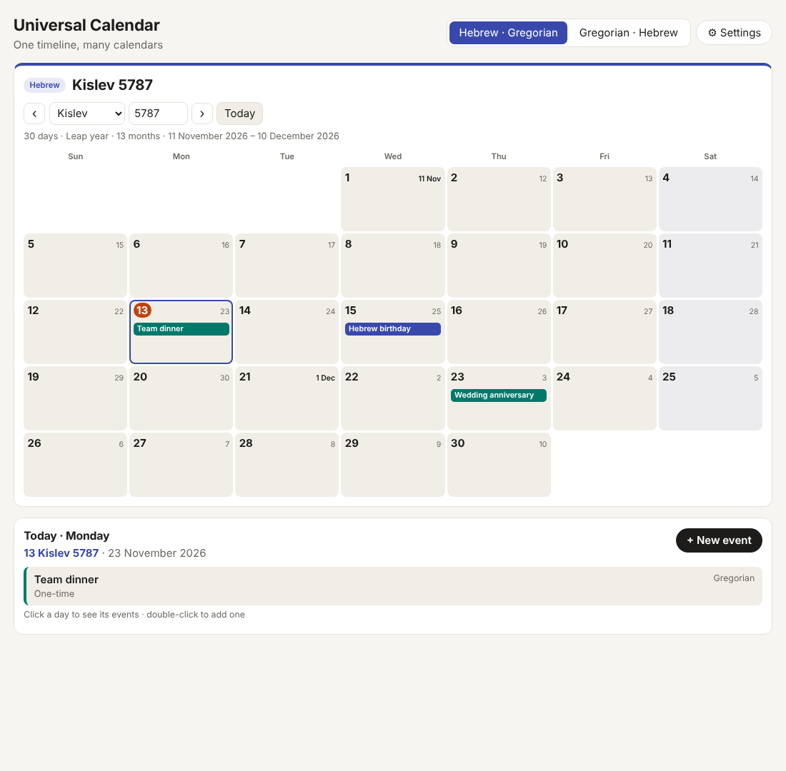

# עִתִּים · Ittim

> כל הלוחות ללא פשרות — every calendar, no compromise. The Hebrew calendar is respected as fully as the
> Gregorian one: a date set in Hebrew stays that Hebrew date, never a translation. (Formerly "Universal Calendar".)

A calendar-neutral scheduling app in which the **Hebrew** and **Gregorian** calendars are both first-class.
An event keeps the meaning of the calendar it was created in. "15 Kislev, every year" stays 15 Kislev,
and its occurrences appear on the correct day in every calendar view and in an Apple Calendar subscription.

- One month view, switchable between **Hebrew · Gregorian** and **Gregorian · Hebrew**. In Hebrew mode the
  grid is built from real Hebrew months (Adar I and Adar II in leap years, 29- or 30-day Cheshvan and
  Kislev), with the Gregorian date shown in each cell; in Gregorian mode it is the other way round.
- A day list under the month, like Apple Calendar's list: it shows the selected day's events (today by default).
- Events are added from either calendar and can repeat **daily, weekly, monthly or yearly, every N units**.
  Monthly and yearly rules follow the event's own calendar (a Hebrew monthly event follows Hebrew months),
  with RFC 7529 handling for dates that don't exist in a given month or year.
- **Multiple calendars** ("Personal", "Work", …) in an Apple Calendar-style side panel: colour, show/hide,
  a separate Apple Calendar link for each, and export of any chosen calendars as `.ics` or a lossless `.json` backup.
- **Computed calendars:** Jewish holidays (festivals, minor holidays, fasts, national days, Rosh Chodesh) are
  a calendar in the same list, filled in automatically from rules inside the app — no runtime holiday library.
  Its *settings* (Israel or diaspora, which categories) belong to the calendar itself, so they are the same on
  every device and in its feed. Delete it for a clean calendar, or add more (e.g. one for Israel, one for the
  diaspora; one with only Rosh Chodesh). You cannot add events to it.
- **Shabbat & festival times** in a computed calendar: choose a city (Israel and abroad) or your current
  location, the candle-lighting minutes (Israel 20, Jerusalem 40, Haifa 30, abroad 18 by default) and the
  havdalah method (nightfall at 8.5° / 7.083°, or 42 / 50 / 72 minutes). Candle lighting and havdalah appear
  for every Shabbat and Yom Tov, including second days (lit after nightfall) and Yom Tov on Friday. Sunset is
  computed by our own implementation of NOAA's solar algorithm — verified against Hebcal: every one of 3,402
  candle-lighting and havdalah times over two years in seven cities matches to the minute.
- **Weekly Torah portion, special Shabbatot and the Omer** as optional categories of a computed calendar —
  Israel or diaspora, our own rules (fixed points: Tzav before Pesach in a common year, Bamidbar before
  Shavuot, Devarim before Tisha B'Av, Nitzavim before Rosh Hashana; pairs joined only when needed).
  Verified against Hebcal for 60 years: all 5,976 portions, 549 special Shabbatot and 2,989 Omer days match.
- A JSON event store (documented schema) on disk locally, or in Redis on Vercel.
- A live ICS feed (`/calendar.ics`) with stable UIDs, for Apple Calendar subscriptions.
- English (LTR) and Hebrew (RTL) interface, light and dark, in a design language inspired by iOS
  Calendar: glass toolbars, large titles, sheets that rise from the bottom on phones, grouped forms,
  and a bottom toolbar (Today · Calendars · +) on phones. Language, the feed link, storage status and the
  edit token are in **Settings**.



<details><summary>Hebrew interface (RTL)</summary>


</details>

See **[ARCHITECTURE.md](./ARCHITECTURE.md)** for the data model, standards, design decisions and limitations.

## Requirements

- Node.js 20.9 or newer (developed and tested on Node 22)
- npm

## Run locally

```bash
npm install
npm run dev            # http://localhost:3000
```

Events are saved to `data/events.json`. Production mode:

```bash
npm run build
npm start              # http://localhost:3000
```

## Use

- **Choose the display:** the ⇄ button at the top switches between *Hebrew · Gregorian* and
  *Gregorian · Hebrew*. The view stays on the same day, and the choice is remembered in this browser.
- **See a day's events:** click a day. The list below the month shows that day's events in both calendars.
  *Today* jumps back to today and shows today's events.
- **Add an event:** press *+ New event* under the month, or double-click a day. The editor opens in the
  current display's main calendar. You can switch it to the other calendar; the date is re-expressed as
  the same day.
- **Repeat** (as in Apple Calendar): *Never*, *Every Day*, *Every Week*, *Every 2 Weeks*, *Every Month*,
  *Every Year*, or *Custom…* (every N days/weeks/months/years). **End Repeat**: *Never* or *On Date*.
  Monthly and yearly repeats follow the event's own calendar. If the date can be missing (the 30th in a
  29-day Hebrew month, the 31st, Adar I, 29 February), the editor asks what to do: next day (default),
  previous day, or skip.
- **Edit or delete:** click an event in the month or in the day list. For a repeating event the editor
  opens on the occurrence you clicked, and saving or deleting asks — as in Apple Calendar — **This Event
  Only** or **All Future Events**. Changing how it repeats always applies from that occurrence on.
- **Navigate:** use ‹ › to move between months, or pick a month or year.
- **Calendars panel (side):** tick a calendar to show or hide it; **⋯** renames it, changes its colour,
  copies its Apple Calendar link, exports it (`.ics` / `.json`) or deletes it (with its events, after a
  second click; a computed calendar can always be deleted and added again). **+ New calendar** adds one —
  choose *Regular* or *Jewish holidays*. **Export** lets you tick which calendars to include.
- **Holiday explanations:** each holiday has an icon in the month view; selecting a day shows a card
  with a short explanation (Hebrew/English) and a *Read more* link. The holidays feed carries both too.
- **Holidays:** untick *Jewish holidays* to hide it, or delete it for a clean calendar; its **⋯** chooses
  Israel or diaspora and the categories, and copies its own Apple Calendar link.
- **Keyboard:** the whole calendar works from the keyboard — press **?** (or the keyboard button in the top bar, shown on computers with a mouse) for the list. Arrows move by day
  (following the grid's direction, so they mirror in Hebrew) and week; PageUp/PageDown or Shift+arrows by
  month; Shift+↑/↓ by year; Home/End; **T** today, **N** new event, **Enter** open, **M** Hebrew ⇄ Gregorian,
  **C** calendars, **,** settings, **Esc** close, **⌘/Ctrl+Enter** save in the editor. Letter keys are
  matched by physical key, so they work with a Hebrew layout too.
- **Settings (⚙):** interface language (עברית / English), appearance (automatic, light or dark), the
  Apple Calendar subscription link, storage status, and the edit token if the server requires one.

## Standalone preview (no server)

```bash
npm run build:preview   # → dist/preview.html
```

This creates one self-contained HTML file that runs the same app entirely in the browser. Events are saved
in that browser's localStorage, a few sample events are added on first visit, and there is no ICS feed.
It's useful for trying the UI or sharing a demo. Open the file directly, or host it anywhere.

## Tests

```bash
npm test               # 56 tests (incl. holidays vs Hebcal, 5710–5899): conversions vs ICU, recurrence, ICS, storage
npm run typecheck
```

## Apple Calendar subscription

The app publishes `GET /calendar.ics`. In Apple Calendar on a Mac, choose **File → New Calendar
Subscription…** and enter the feed URL. On iPhone, go to **Settings → Calendar → Accounts → Add Account →
Other → Add Subscribed Calendar**.

- Apple's servers and devices must be able to reach the URL, so it must be **public** (your Vercel
  deployment). `localhost` will not work.
- Use `webcal://your-app.vercel.app/calendar.ics`, or `https://…`; Apple accepts both. If `UC_FEED_TOKEN`
  is set, append `?token=…`.
- The feed covers the past year and the next three years, recomputed on every request. Apple refreshes on
  its own schedule. The feed suggests every 6 hours, and you can set the refresh frequency in the
  subscription's settings.
- Edits keep each occurrence's UID, so Apple Calendar updates entries in place rather than duplicating them.

> **Verification status:** the feed has been validated with two independent iCalendar parsers (ical.js and
> Python `icalendar`), including UID stability across edits. It has **not** yet been subscribed to from a
> real Apple Calendar client, which needs a public deployment. Please do that check once deployed: add the
> subscription, edit an event, refresh, and confirm the occurrence moved and was not duplicated.

## Storage

| Where it runs | Storage | Configuration |
|---|---|---|
| `npm run dev` / `npm start` / any Node host | `data/events.json` | none (or `UC_DATA_FILE`) |
| Vercel | Redis (Upstash or Vercel's Redis) | Detected automatically: `REDIS_URL` / `KV_URL`, or Upstash REST pairs (`KV_REST_API_*`, `UPSTASH_REDIS_REST_*`, or any custom prefix). `/api/status` lists the variable names it found. |
| Vercel **without** Redis | the browser's localStorage only | The app shows a warning. The ICS feed will be empty, because the server can't see browser data. |

All variables are listed in [`.env.example`](./.env.example).

## Use it like an app (iPhone)

Open the site in **Safari**, tap **Share** (the square with an arrow), then **Add to Home Screen** and **Add**.
It opens full screen from its own icon, with no browser bars (web-app manifest + Apple web-app metadata,
`src/app/manifest.ts`, `src/app/apple-icon.png`). The home-screen app keeps its own sign-in, so sign in once
inside it. Icons and the manifest are public (the phone fetches them without the login cookie).

## Security notes

**Owner login (user + password).** Set `UC_USER` and `UC_PASSWORD` in the hosting environment
(Vercel → Settings → Environment Variables, then redeploy). They are read at runtime and never stored in the
repository, so they are not visible on GitHub. With both set:
- **only the signed-in owner can add, change or delete** events and calendars. Every API route that changes
  data refuses requests without a valid session, whatever the browser shows;
- **the calendar is private by default**: every page and the API need the login, so a casual visitor sees
  only the sign-in screen. Calendar apps cannot log in, so the events feed needs a private `?token=…`;
  Settings adds it to the link it shows. It is derived from the credentials (changing the password changes
  the link) unless `UC_FEED_TOKEN` is set. Share that link only with devices or people who should see it;
- `UC_VISIBILITY=public` opens viewing instead: visitors see the calendar read-only, with a "Sign in to
  edit" button, and the feeds need no token;
- sessions are HMAC-signed, HttpOnly cookies valid for 30 days; changing the password signs out every device;
- repeated wrong passwords are slowed down and then locked out for a growing period;
- if only one of the two variables is set, the app refuses all access instead of running unprotected.


- With no tokens set, **anyone who knows the address can read and change the calendar**. For a public
  deployment set `UC_EDIT_TOKEN` (required to read *and* write events through the API; the UI asks for it
  once per browser) and `UC_FEED_TOKEN` (required by the `.ics` feeds).
- Limits: 5,000 events, 50 calendars, 64 KB per request.
- Security headers on every response: no framing (clickjacking), `nosniff`, `no-referrer`, restricted
  permissions.
- Keep a backup: *Settings → Export → .json* saves everything, including Hebrew dates and rules.
- Restore or merge a backup: *Settings → Import → .json*. It adds calendars (matched by name) and events;
  nothing is deleted or overwritten, and events that already exist are skipped, so importing twice is safe.

## Deploy: GitHub and Vercel

1. **Push to GitHub**
   ```bash
   git init && git add . && git commit -m "Ittim MVP"   # (already done if you received the repo)
   gh repo create universal-calendar --public --source=. --push       # or create the repo on github.com and:
   # git remote add origin git@github.com:<you>/universal-calendar.git && git push -u origin main
   ```
2. **Import into Vercel**: at vercel.com go to **Add New → Project**, pick the repository and keep the
   defaults (framework: Next.js). You can also run `npx vercel` from the project folder.
3. **Add storage**: in the Vercel project, go to **Storage → Marketplace → Upstash (Redis) → Create**, then
   connect it to the project. This sets `KV_REST_API_URL` and `KV_REST_API_TOKEN` automatically.
   Alternatively, create a free database at upstash.com and add `UPSTASH_REDIS_REST_URL` and
   `UPSTASH_REDIS_REST_TOKEN` under **Settings → Environment Variables**.
4. **Protect it** (recommended for a public URL): add `UC_EDIT_TOKEN` and `UC_FEED_TOKEN` (two different
   random strings), for example from `openssl rand -hex 24`.
5. **Redeploy** so the variables take effect. Open the site; **Settings → Storage** should say
   "Saved on the server (redis)".
6. **Subscribe** in Apple Calendar to `webcal://<your-app>.vercel.app/calendar.ics?token=<UC_FEED_TOKEN>`.

> These deployment steps follow Vercel's and Upstash's standard flows. The app was built, run and tested
> locally (file storage, browser fallback, tokens and the ICS feed), but it has **not** been deployed to
> Vercel or connected to a live Upstash database from this environment.

## Project layout

```
src/core/            framework-free calendar core (no React, no Next.js)
  time/epochDay.ts     universal day axis
  calendars/           CalendarAdapter interface, Hebrew (Hebcal) and Gregorian (Temporal) engines
  events/              schema v1, validation, recurrence expansion, rule descriptions
  export/ics.ts        ICS output adapter
src/server/          storage backends (file / Upstash Redis / none), HTTP helpers
src/app/             Next.js routes: page, /api/events, /api/status, /calendar.ics
src/ui/              React views: MonthView (generic), EventEditor, App, i18n, repositories
tests/               vitest suites
```

## API

| Method | Path | Body | Notes |
|---|---|---|---|
| GET | `/api/events` | | `{ schemaVersion, events, storage }` |
| POST | `/api/events` | `EventInput` | 201 with the stored event |
| PUT | `/api/events/:uid` | `EventInput` | Increments `sequence` |
| DELETE | `/api/events/:uid` | | 204 |
| GET | `/api/status` | | storage kind, whether tokens are required |
| POST | `/api/collections` | `{ name, color, kind?, jewish? }` | create a calendar (`kind`: `events` or `jewish`) |
| PUT / DELETE | `/api/collections/:id` | `{ name, color, jewish? }` | rename/recolour/settings; delete removes its events |
| GET | `/calendar.ics` | | every calendar; `?collection=<id>` one; `?collections=<id>,<id>` a set; `&lang=he\|en`; `&download=1` |
| GET | `/holidays.ics` | | legacy (kept for old subscriptions): `?region=…&categories=…&lang=…` |

`EventInput`:
```json
{
  "title": "Hebrew birthday",
  "description": "optional",
  "start": { "calendar": "hebrew", "year": 5787, "monthCode": "M03", "day": 15 },
  "recurrenceRules": [{ "frequency": "yearly", "skip": "forward" }]
}
```
Month codes follow Temporal: Hebrew `M01` Tishrei … `M05` Shevat, `M05L` Adar I, `M06` Adar/Adar II,
`M07` Nisan … `M12` Elul; Gregorian `M01`–`M12`.

Events are all-day unless `showWithoutTime` is `false` (Apple's *All-day* switch off); then they need a
wall-clock time, a length and an IANA time zone:
```json
{ "title": "Seder", "start": { "calendar": "hebrew", "year": 5787, "monthCode": "M07", "day": 15 },
  "showWithoutTime": false, "startTime": "19:30", "durationMinutes": 240, "timeZone": "Asia/Jerusalem",
  "recurrenceRules": [{ "frequency": "yearly" }] }
```
The time stays the same local time on every occurrence, also across daylight-saving changes (a time that
does not exist that day moves forward by the gap; one that happens twice takes the first). In `.ics` each
timed occurrence gets its exact UTC start and end (no VTIMEZONE), and is marked busy; all-day ones keep DATE
values and are free. One occurrence of a repeating timed event can have its own time ("This Event Only");
switching *All-day* on or off applies to the whole series or all future events.

## License

The Hebrew calendar engine, [Hebcal](https://github.com/hebcal/hebcal-es6), is licensed
**GPL-2.0-or-later** and is bundled into the browser code, so this project is declared
`GPL-2.0-or-later` in `package.json`. If you need a permissive license instead, the Hebrew adapter can be
re-implemented on Temporal/ICU (MIT polyfill). The adapter interface and the ICU cross-check tests are
already in place for that swap.
