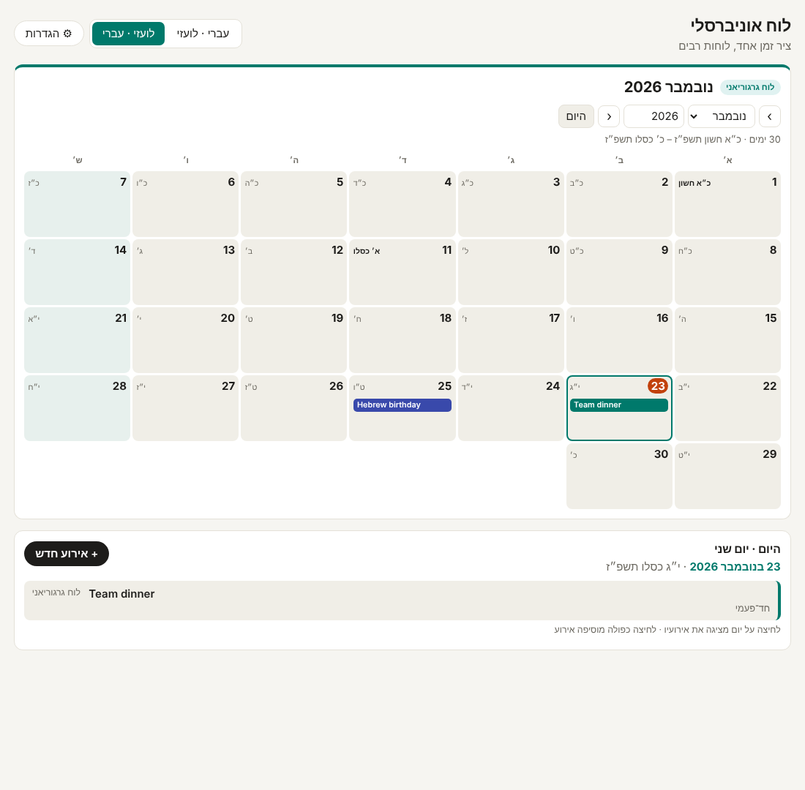

# Universal Calendar

A calendar-neutral scheduling app in which the **Hebrew** and **Gregorian** calendars are both first-class.
An event keeps the meaning of the calendar it was created in. "15 Kislev, every year" stays 15 Kislev,
and its occurrences appear on the correct day in every calendar view and in an Apple Calendar subscription.

- One month view, switchable between **Hebrew · Gregorian** and **Gregorian · Hebrew**. In Hebrew mode the
  grid is built from real Hebrew months (Adar I and Adar II in leap years, 29- or 30-day Cheshvan and
  Kislev), with the Gregorian date shown in each cell; in Gregorian mode it is the other way round.
- A day list under the month, like Apple Calendar's list: it shows the selected day's events (today by default).
- Events are added from either calendar and can repeat **daily, weekly, monthly or yearly, every N units**.
  Monthly and yearly rules follow the event's own calendar (a Hebrew monthly event follows Hebrew months),
  with RFC 7529 handling for dates that don't exist in a given month or year.
- **Multiple calendars** ("Personal", "Work", …) in an Apple Calendar-style side panel: colour, show/hide,
  a separate Apple Calendar link for each, and export of your own events as `.ics` or a lossless `.json` backup.
- **Built-in Jewish holidays** (festivals, minor holidays, fasts, national days, Rosh Chodesh; Israel or
  diaspora), defined as rules inside the app — no runtime holiday library. Switch them off entirely for a
  clean calendar, or choose categories. A separate `/holidays.ics` feed is available.
- A JSON event store (documented schema) on disk locally, or in Redis on Vercel.
- A live ICS feed (`/calendar.ics`) with stable UIDs, for Apple Calendar subscriptions.
- English (LTR) and Hebrew (RTL) interface; responsive. Language, the feed link, storage status and the
  edit token are in **Settings**.


<details><summary>Hebrew interface (RTL)</summary>


</details>

See **[ARCHITECTURE.md](./ARCHITECTURE.md)** for the data model, standards, design decisions and limitations.

## Requirements

- Node.js 20.9 or newer (developed and tested on Node 22)
- npm

## Run locally

```bash
npm install
npm run dev            # http://localhost:3000
```

Events are saved to `data/events.json`. Production mode:

```bash
npm run build
npm start              # http://localhost:3000
```

## Use

- **Choose the display:** the ⇄ button at the top switches between *Hebrew · Gregorian* and
  *Gregorian · Hebrew*. The view stays on the same day, and the choice is remembered in this browser.
- **See a day's events:** click a day. The list below the month shows that day's events in both calendars.
  *Today* jumps back to today and shows today's events.
- **Add an event:** press *+ New event* under the month, or double-click a day. The editor opens in the
  current display's main calendar. You can switch it to the other calendar; the date is re-expressed as
  the same day.
- **Old events:** if the event's date is in the past and you set it to repeat, repeats start **from
  today** by default (the past isn't filled in; the original date is kept). Choose *From the event's date*
  to include past years.
- **Repeat:** choose *Does not repeat*, *Daily*, *Weekly*, *Monthly* or *Yearly*, and "every N". Monthly
  and yearly follow the event's calendar. If the date can be missing (the 30th in a 29-day Hebrew month,
  the 31st, Adar I, 29 February), the editor asks what to do: move forward (default), move back, or skip.
- **Edit or delete:** click an event in the month or in the day list.
- **Navigate:** use ‹ › to move between months, or pick a month or year.
- **Calendars panel (side):** tick a calendar to show or hide it; **⋯** renames it, changes its colour,
  copies its Apple Calendar link, exports it (`.ics` / `.json`) or deletes it (with its events, after a
  second click). **+ New calendar** adds one. *Export all my events* never includes built-in holidays.
- **Holidays:** under *Built-in*, untick *Jewish holidays* for a clean calendar; **⋯** chooses Israel or
  diaspora and which categories to show, and copies a holidays-only Apple Calendar link.
- **Settings (⚙):** interface language (עברית / English), appearance (automatic, light or dark), the
  Apple Calendar subscription link, storage status, and the edit token if the server requires one.

## Standalone preview (no server)

```bash
npm run build:preview   # → dist/preview.html
```

This creates one self-contained HTML file that runs the same app entirely in the browser. Events are saved
in that browser's localStorage, a few sample events are added on first visit, and there is no ICS feed.
It's useful for trying the UI or sharing a demo. Open the file directly, or host it anywhere.

## Tests

```bash
npm test               # 56 tests (incl. holidays vs Hebcal, 5710–5899): conversions vs ICU, recurrence, ICS, storage
npm run typecheck
```

## Apple Calendar subscription

The app publishes `GET /calendar.ics`. In Apple Calendar on a Mac, choose **File → New Calendar
Subscription…** and enter the feed URL. On iPhone, go to **Settings → Calendar → Accounts → Add Account →
Other → Add Subscribed Calendar**.

- Apple's servers and devices must be able to reach the URL, so it must be **public** (your Vercel
  deployment). `localhost` will not work.
- Use `webcal://your-app.vercel.app/calendar.ics`, or `https://…`; Apple accepts both. If `UC_FEED_TOKEN`
  is set, append `?token=…`.
- The feed covers the past year and the next three years, recomputed on every request. Apple refreshes on
  its own schedule. The feed suggests every 6 hours, and you can set the refresh frequency in the
  subscription's settings.
- Edits keep each occurrence's UID, so Apple Calendar updates entries in place rather than duplicating them.

> **Verification status:** the feed has been validated with two independent iCalendar parsers (ical.js and
> Python `icalendar`), including UID stability across edits. It has **not** yet been subscribed to from a
> real Apple Calendar client, which needs a public deployment. Please do that check once deployed: add the
> subscription, edit an event, refresh, and confirm the occurrence moved and was not duplicated.

## Storage

| Where it runs | Storage | Configuration |
|---|---|---|
| `npm run dev` / `npm start` / any Node host | `data/events.json` | none (or `UC_DATA_FILE`) |
| Vercel | Redis (Upstash or Vercel's Redis) | Detected automatically: `REDIS_URL` / `KV_URL`, or Upstash REST pairs (`KV_REST_API_*`, `UPSTASH_REDIS_REST_*`, or any custom prefix). `/api/status` lists the variable names it found. |
| Vercel **without** Redis | the browser's localStorage only | The app shows a warning. The ICS feed will be empty, because the server can't see browser data. |

All variables are listed in [`.env.example`](./.env.example).

## Security notes

- With no tokens set, **anyone who knows the address can read and change the calendar**. For a public
  deployment set `UC_EDIT_TOKEN` (required to read *and* write events through the API; the UI asks for it
  once per browser) and `UC_FEED_TOKEN` (required by the `.ics` feeds).
- Limits: 5,000 events, 50 calendars, 64 KB per request.
- Security headers on every response: no framing (clickjacking), `nosniff`, `no-referrer`, restricted
  permissions.
- Keep a backup: *Settings → Export → .json* saves everything, including Hebrew dates and rules.

## Deploy: GitHub and Vercel

1. **Push to GitHub**
   ```bash
   git init && git add . && git commit -m "Universal Calendar MVP"   # (already done if you received the repo)
   gh repo create universal-calendar --public --source=. --push       # or create the repo on github.com and:
   # git remote add origin git@github.com:<you>/universal-calendar.git && git push -u origin main
   ```
2. **Import into Vercel**: at vercel.com go to **Add New → Project**, pick the repository and keep the
   defaults (framework: Next.js). You can also run `npx vercel` from the project folder.
3. **Add storage**: in the Vercel project, go to **Storage → Marketplace → Upstash (Redis) → Create**, then
   connect it to the project. This sets `KV_REST_API_URL` and `KV_REST_API_TOKEN` automatically.
   Alternatively, create a free database at upstash.com and add `UPSTASH_REDIS_REST_URL` and
   `UPSTASH_REDIS_REST_TOKEN` under **Settings → Environment Variables**.
4. **Protect it** (recommended for a public URL): add `UC_EDIT_TOKEN` and `UC_FEED_TOKEN` (two different
   random strings), for example from `openssl rand -hex 24`.
5. **Redeploy** so the variables take effect. Open the site; **Settings → Storage** should say
   "Saved on the server (redis)".
6. **Subscribe** in Apple Calendar to `webcal://<your-app>.vercel.app/calendar.ics?token=<UC_FEED_TOKEN>`.

> These deployment steps follow Vercel's and Upstash's standard flows. The app was built, run and tested
> locally (file storage, browser fallback, tokens and the ICS feed), but it has **not** been deployed to
> Vercel or connected to a live Upstash database from this environment.

## Project layout

```
src/core/            framework-free calendar core (no React, no Next.js)
  time/epochDay.ts     universal day axis
  calendars/           CalendarAdapter interface, Hebrew (Hebcal) and Gregorian (Temporal) engines
  events/              schema v1, validation, recurrence expansion, rule descriptions
  export/ics.ts        ICS output adapter
src/server/          storage backends (file / Upstash Redis / none), HTTP helpers
src/app/             Next.js routes: page, /api/events, /api/status, /calendar.ics
src/ui/              React views: MonthView (generic), EventEditor, App, i18n, repositories
tests/               vitest suites
```

## API

| Method | Path | Body | Notes |
|---|---|---|---|
| GET | `/api/events` | | `{ schemaVersion, events, storage }` |
| POST | `/api/events` | `EventInput` | 201 with the stored event |
| PUT | `/api/events/:uid` | `EventInput` | Increments `sequence` |
| DELETE | `/api/events/:uid` | | 204 |
| GET | `/api/status` | | storage kind, whether tokens are required |
| POST | `/api/collections` | `{ name, color }` | create a calendar |
| PUT / DELETE | `/api/collections/:id` | `{ name, color }` | rename/recolour; delete removes its events |
| GET | `/calendar.ics` | | all your events; `?collection=<id>` for one calendar; `&download=1` as a file |
| GET | `/holidays.ics` | | `?region=il\|diaspora&categories=major,minor,fast,modern,roshchodesh&lang=he\|en` |

`EventInput`:
```json
{
  "title": "Hebrew birthday",
  "description": "optional",
  "start": { "calendar": "hebrew", "year": 5787, "monthCode": "M03", "day": 15 },
  "recurrenceRules": [{ "frequency": "yearly", "skip": "forward" }]
}
```
Month codes follow Temporal: Hebrew `M01` Tishrei … `M05` Shevat, `M05L` Adar I, `M06` Adar/Adar II,
`M07` Nisan … `M12` Elul; Gregorian `M01`–`M12`.

## License

The Hebrew calendar engine, [Hebcal](https://github.com/hebcal/hebcal-es6), is licensed
**GPL-2.0-or-later** and is bundled into the browser code, so this project is declared
`GPL-2.0-or-later` in `package.json`. If you need a permissive license instead, the Hebrew adapter can be
re-implemented on Temporal/ICU (MIT polyfill). The adapter interface and the ICU cross-check tests are
already in place for that swap.
